# Caravan Power

An ESP32 system that links all of the caravan's power, water and climate systems together. It shows them on a **7" Waveshare touchscreen** inside the van, serves a **web dashboard you can open from anywhere** over Starlink, and sends **push alerts to your phone**.

It talks to the BMPRO system **wirelessly through the OdysseyLink** (the same Bluetooth link the Odyssey phone app uses). Battery, tank levels and pump control need no extra wiring, and the touchscreen **replaces the Trek 3**.

> **Status:** BMPRO doesn't publish the OdysseyLink's Bluetooth protocol, so it has to be captured and decoded once before battery, tanks and pumps appear. The hub includes the tools for this, and [docs/BMPRO_INTEGRATION.md](docs/BMPRO_INTEGRATION.md) walks through it. Solar, temperatures, inverter, aircon, alerts and cloud access work without it.

| Touchscreen: home | Touchscreen: alarm |
|---|---|
| 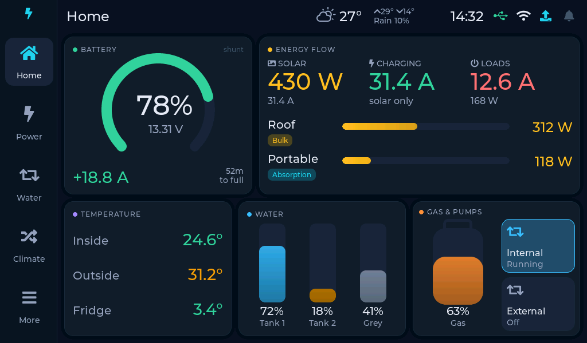 |  |
| **Power** (per-MPPT tracking + 30 min history) | **Water** (tanks + pump control) |
| 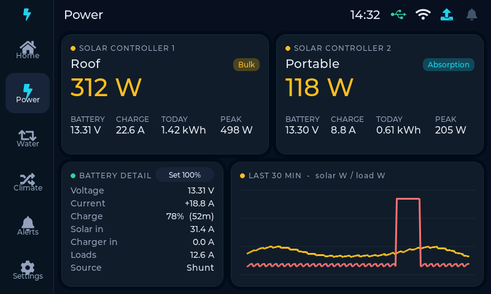 | 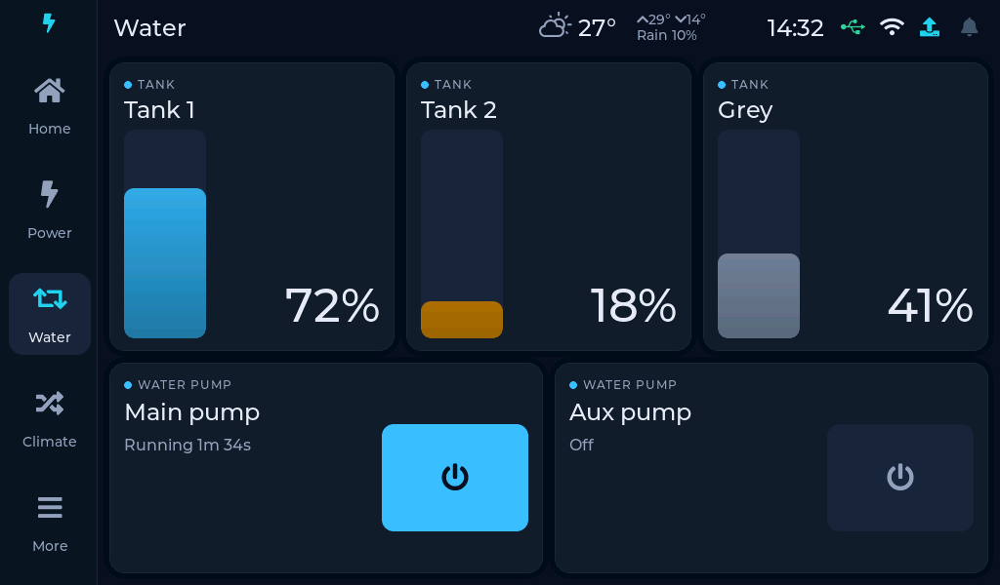 |
| **Climate** (temps + weather forecast) | **More** (Level, Alerts & rules, Settings: out of the way) |
| 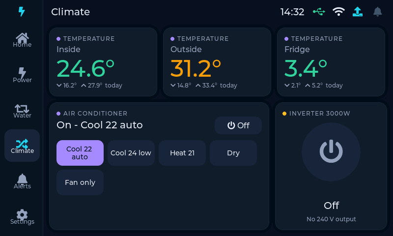 | 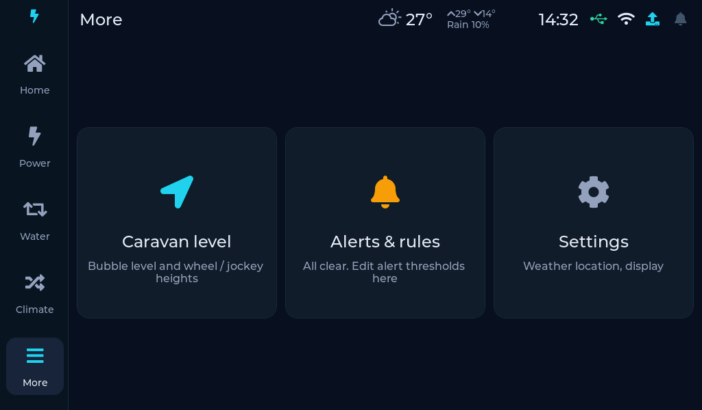 |
| **Alerts** (active alerts + editable rules) | |
|  | |
| **Forecast** (tap the weather in the status bar) | **Level** (bubble + wheel/jockey mm) |
| 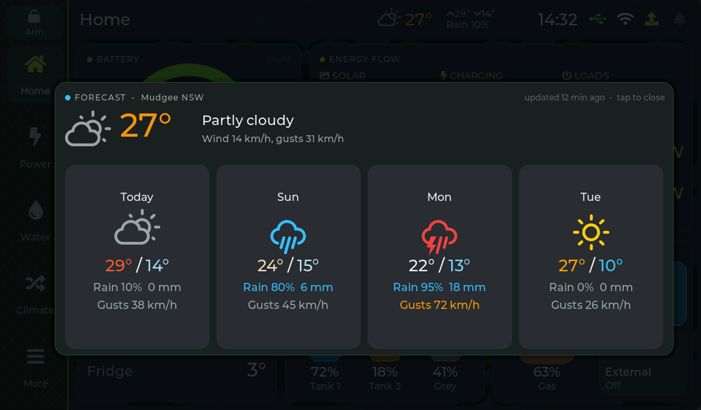 | 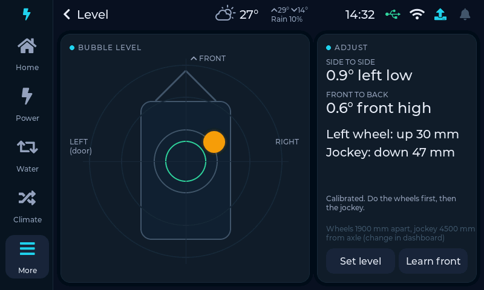 |
| **Level on your phone** (Bluetooth) | **Weather location** (town search on the touchscreen) |
| 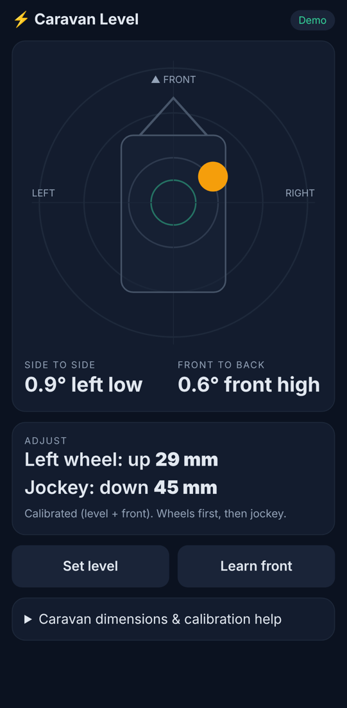 | 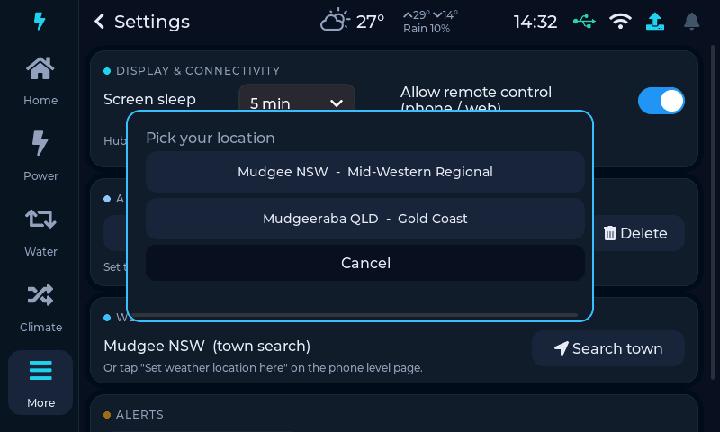 |
| **Phone: once level, set the weather location** | **Touchscreen: once level** |
| 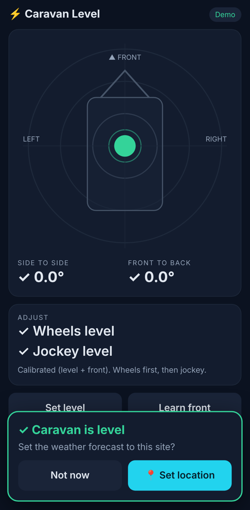 | 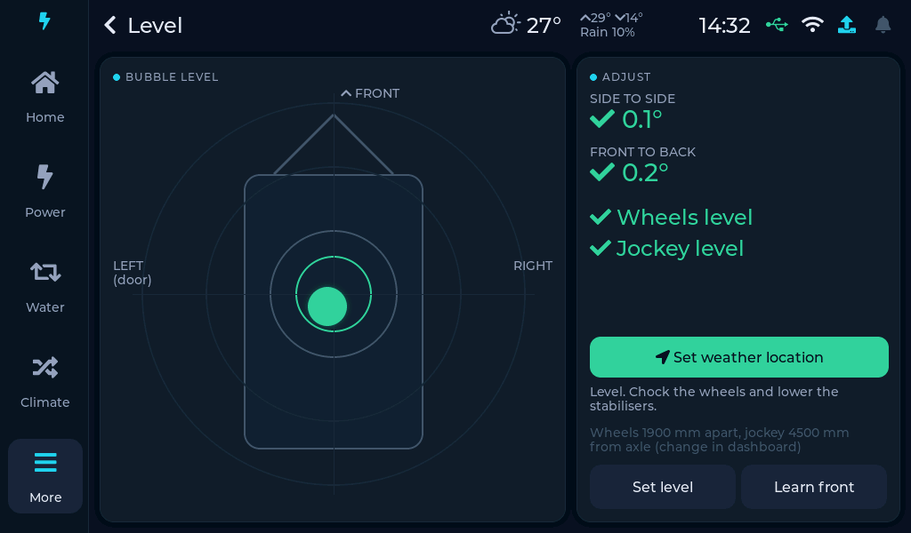 |

Remote dashboard (desktop and phone, dark and light):

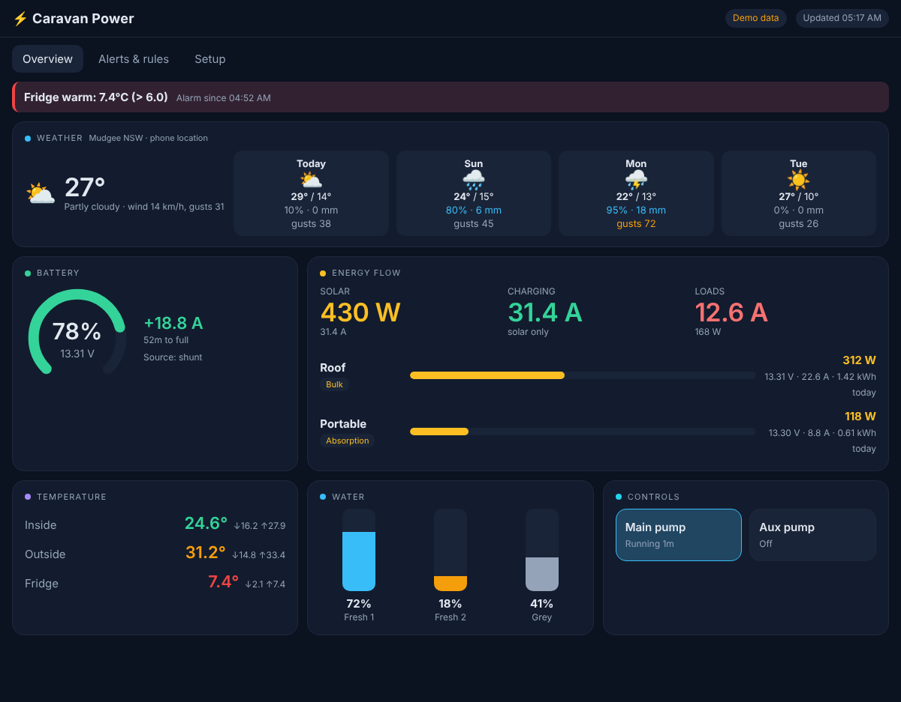 

> The screenshots are rendered from the real UI code (see [`tests/sim`](tests/sim)), with demo data.

## What it does

| Requirement | How |
|---|---|
| Battery %, load amps, charge amps | From the BMPRO via the OdysseyLink (Bluetooth). Charge amps also from the Victrons. Fallback: INA226 shunt |
| Individual solar controller tracking | Both Victron SmartSolar 100/50s over **Bluetooth** (Victron Instant Readout, no cables): PV watts, charge A, battery V, charge state, yield today, peak, errors. VE.Direct cable optional (adds PV voltage) |
| Inside / outside / fridge temps with alarms | **Bluetooth thermometers** (e.g. magnetic ThermoPro TP357, Shelly BLU H&T) or wired DS18B20s, mixed per role. Min/max today, sensor battery warnings, alarm rules with delay and hysteresis |
| Customisable alerts on temps, volts and amps | Rule engine: any metric, above/below, threshold, hysteresis, delay, severity, push on/off, plus an optional **automatic action** (aircon off, inverter off, pumps off) |
| Phone alerts | [ntfy](https://ntfy.sh) push (free iOS/Android app). Alarms use *urgent* priority |
| 2 water pumps on the touchscreen | Switched **by the BMPRO**, commanded over Bluetooth, so the Odyssey app stays in sync. Dry-run lockout and a max run time. Fallback: relays |
| Water tank gauges | Your tank sensors already report to the OdysseyLink; the hub reads the levels from it over Bluetooth (no wiring). Fallback: ADS1115 taps |
| Remove the Trek 3 | The touchscreen covers everything the Trek showed. Follow the test-before-removing steps in the BMPRO doc |
| Inverter control *(switched off for now)* | Relay on the Powertech remote port (pulse or latch), with a 240 V output sense |
| Air-con control *(switched off for now)* | Learns IR codes from the Houghton remote and replays them (up to 8 presets plus OFF) |
| Remote access over Starlink | Outbound MQTT over TLS, so it works behind Starlink CGNAT with no port forwarding |
| Weather forecast | Current conditions in the touchscreen's status bar (on every page, including Home); tap for a 4-day forecast. The full forecast also fills the Climate page. Also on the dashboard. From [Open-Meteo](https://open-meteo.com) (free, no key). Location set with one tap when the phone level page says the van is level, a town search on the touchscreen, or the dashboard; no GPS module needed (one is supported but optional). Forecast gusts / rain chance can trigger alerts (default: "Strong wind forecast" > 50 km/h) |
| Caravan levelling | MPU-6050 on the hub. Bubble level + "raise left wheel 30 mm / jockey down 45 mm" on the touchscreen and **on your phone over Bluetooth** (no Wi-Fi needed). Sensor can be mounted at any angle: *Set level* + *Learn front* calibration, saved permanently |
| Modern UI on the 7" Waveshare | LVGL 8.3 dark UI, 1024×600 (Waveshare 7B). Layouts are computed from the panel resolution, so nothing is pinned to one screen size. The rail shows only everyday pages (Home, Power, Water, Climate); Level, Alerts & rules and Settings sit behind **More**. Tap the bell for alerts. Screen sleeps, wakes on alarm |

> **Inverter and aircon control are switched off for now.** They'll be added to the project later. The code is still there behind two flags in [`firmware/display/src/ui/ui.h`](firmware/display/src/ui/ui.h): build with `-DFEATURE_INVERTER_CONTROL=1` and/or `-DFEATURE_AIRCON_CONTROL=1` (in `build_flags` in the display's `platformio.ini`) to bring back the Home tiles, the Climate cards and the aircon section in Settings, and set `FEATURES` at the top of the script in `web/index.html` to bring back the dashboard buttons. While they're off, the Climate page shows the weather forecast instead.

## Architecture

```
                         Starlink ── internet ── MQTT broker (TLS) ── phone / laptop dashboard
                             │                        ▲                  (web/index.html)
                         Wi-Fi                        │ outbound only            ntfy push
                             │                        │                              ▲
 ┌───────────────────────────┴────────────────────────┴──────────────────────────────┴────┐
 │ HUB  ESP32-S3-DevKitC-1                                                                │
 │  Bluetooth ))))) OdysseyLink ── BMPRO 35A: battery, 3 tank senders, pump 1 + 2       │
 │  Bluetooth ))))) SmartSolar 100/50 #1, #2 (Instant Readout)                            │
 │  Bluetooth ))))) thermometers: fridge / outside / inside (or 1-Wire DS18B20 probes)     │
 │  Relay ── inverter remote      Opto ── inverter 240 V present                          │
 │  IR LED / IR receiver ── Houghton aircon        I²C ── MPU-6050 level sensor           │
 │  HTTPS ── Open-Meteo forecast (location from phone / town search)                      │
 │  Bluetooth level service ))))) phone level page (web/level.html)                       │
 │  Local web UI http://caravan.local  +  WebSocket                                       │
 │  (optional wired fallbacks: VE.Direct, INA226 shunt, ADS1115 tank taps, pump relays)   │
 └──────────────────────────────┬─────────────────────────────────────────────────────────┘
                                │ RS485 (4-core: 12 V, GND, A, B)
 ┌──────────────────────────────┴───────────────┐
 │ DISPLAY  Waveshare ESP32-S3-Touch-LCD-7B     │      Trek 3: removed
 │ 1024×600 LVGL touchscreen (replaces Trek 3)  │      Odyssey phone app: still works
 └──────────────────────────────────────────────┘
```

**Why two ESP32s?** On the Waveshare 7" board almost every GPIO drives the RGB panel. The only spare I/O is the RS485 port, I²C and a CAN port. So the screen is a pure UI and a cheap ESP32-S3 dev board does all the wiring-heavy work. The wired RS485 link keeps working when Wi-Fi or Starlink is off.

Everything speaks one JSON format (`firmware/lib/CaravanCommon`), whether over the RS485 link, the local WebSocket or MQTT. So the touchscreen, the local web page and the remote dashboard all see the same data and send the same commands.

## Repository layout

```
firmware/
  lib/CaravanCommon/   shared: data model, JSON format, alert engine, VE.Direct parser,
                       SoC estimator, RS485 framing (portable C++, host-tested)
  hub/                 PlatformIO project - ESP32-S3 hub
  display/             PlatformIO project - Waveshare ESP32-S3-Touch-LCD-7B
web/index.html         dashboard (local + cloud), single file, no build step
web/level.html         phone levelling page (Web Bluetooth straight to the hub, works offline)
tests/                 host unit tests (make -C tests) + UI simulator (tests/sim)
docs/                  wiring, cloud setup, BMPRO notes, protocol reference
```

## Quick start

1. **Wire it up.** Follow [docs/WIRING.md](docs/WIRING.md): the RS485 link to the display, the inverter relay and the IR LED. The BMPRO, the Victrons and the temperature sensors are all wireless.
2. **Set up the cloud side** (optional; the system runs fully offline without it) using [docs/CLOUD_SETUP.md](docs/CLOUD_SETUP.md): a free HiveMQ Cloud broker plus the ntfy app.
3. **Flash the hub.**
   ```sh
   cd firmware/hub
   cp src/secrets.example.h src/secrets.h    # Wi-Fi, MQTT, ntfy topic, web password
   pio run -t upload                          # firmware
   pio run -t uploadfs                        # web dashboard -> LittleFS
   pio device monitor                         # watch it find sensors
   ```
4. **Flash the display.**
   ```sh
   cd firmware/display
   pio run -e display-demo -t upload --upload-port COM7  # standalone GUI demo (no hub needed)
   # Later, use -e display instead to show live data from the hub over RS485.
   ```
   The 7B has two USB-C ports. Flash through the **UART port** (CH343, "USB-Enhanced-SERIAL CH343" in Device Manager; COM7 on the development PC, yours may differ). The native-USB port shows no log output. See [HANDOFF.md](HANDOFF.md) section 8 for Windows gotchas.
5. **Commission it** from the touchscreen, under **Settings**:
   - Add the two Victron Bluetooth keys: dashboard → *Setup* → *Victron solar controllers* (see [docs/WIRING.md](docs/WIRING.md#victron-smartsolar-10050-2---bluetooth)).
   - Connect to the OdysseyLink and decode its protocol: [docs/BMPRO_INTEGRATION.md](docs/BMPRO_INTEGRATION.md). Tanks are calibrated in the Odyssey app as before.
   - *(Only when aircon control is switched on, see the note under the feature table)* Learn the aircon presets: set the Houghton remote to e.g. *Cool 22 auto*, tap *Learn preset* and press the remote's button. Repeat for each mode you use, then do *Learn OFF*.
   - Calibrate the level sensor: More → *Caravan level* → *Set level* (and *Learn front*), see [docs/WIRING.md](docs/WIRING.md#level-sensor-mpu-6050).
   - Assign the temperature sensors: dashboard → *Setup* → *Find Bluetooth thermometers*, then pick Inside / Outside / Fridge for each.
6. **Tune the alert rules** on the Alerts page (+/− thresholds) or in the dashboard (full editor). The defaults suit 12 V lithium: see `loadDefaultRules()` in [`CaravanModel.cpp`](firmware/lib/CaravanCommon/src/CaravanModel.cpp).
7. **Remove the Trek 3** once the touchscreen shows battery, tanks and pumps from the BMPRO, and after the unplug test in the BMPRO doc passes.

## How many Bluetooth devices can it handle?

All of them at once, comfortably:

| Device | How it's read | Load on the hub |
|---|---|---|
| 2 × Victron SmartSolar | broadcasts (listen only) | none beyond the scan |
| 2-4 × thermometers | broadcasts (listen only) | none beyond the scan |
| BMPRO OdysseyLink | **one** connection | a single link, the only one the hub keeps open |
| Phones on the level page | the hub *accepts* the connection | up to 2 at once, only while levelling |

**Broadcast devices** need no connection. One continuous scan hears every one of them, whether there are 2 or 20. Each advert is checked against the Victron, thermometer and BMPRO decoders in microseconds. The scan keeps no results in memory, so a busy caravan park full of phones and earbuds doesn't fill up RAM.

**The only connection** is to the OdysseyLink, and it shares the radio with the scan without trouble. Your phone can stay connected to the OdysseyLink at the same time.

**Sharing the radio with Wi-Fi:** the scan listens about 38 % of the time, leaving the rest for Wi-Fi. A device advertising every second is therefore heard many times a minute. The Victrons time out after 30 s of silence and the thermometers after 10 min, so occasional misses never show.

**What does limit it is range:** metal walls, the fridge cabinet, battery boxes. Mount the hub centrally, and check each device's signal strength (dBm) with the dashboard's *Find nearby* / *Find Bluetooth thermometers* buttons. Anything better than about -90 dBm is fine.

## BMPRO integration status

- **Bluetooth connection:** the hub keeps a permanent connection to the OdysseyLink, logs every frame, and can replay writes captured from the Odyssey app.
- **What's left:** two functions to fill in once the protocol is decoded, `Bmpro::decode()` (battery, tanks, pump state) and `Bmpro::encodePump()` (pump on/off).
- **Procedure:** see [docs/BMPRO_INTEGRATION.md](docs/BMPRO_INTEGRATION.md). It uses an Android Bluetooth capture of the Odyssey app, which is the quickest way.
- **If decoding hits a wall** (e.g. encrypted traffic), the wired fallbacks need no code changes, only config and hardware: INA226 shunt, ADS1115 tank taps, pump relays.

## Testing

```sh
git clone --depth 1 -b v7.2.1  https://github.com/bblanchon/ArduinoJson ../ArduinoJson
git clone --depth 1 -b v8.3.11 https://github.com/lvgl/lvgl ../lvgl
make -C tests                 # 182 unit checks under ASan/UBSan: weather + GPS parsing, levelling maths, Bluetooth thermometers, Victron
                              # BLE decrypt (incl. FIPS-197 AES vector), VE.Direct, alerts, JSON, SoC, RS485
make -C tests/sim             # builds the real display UI against LVGL and renders every page at 1024x600 (PPM)
# make -C tests/sim OUT=out-800 RES="-DDISPLAY_HOR_RES=800 -DDISPLAY_VER_RES=480"   # same UI at another size
```

Open [web/touchscreen-demo.html](web/touchscreen-demo.html) in a browser to explore a clickable touchscreen preview without the hub or display. It uses 1024×600 screenshots of the real LVGL interface; navigation and selected controls are simulated rather than running the firmware. The preview loads its images from `docs/img`, so keep that folder alongside `web`.

Open `web/index.html?demo` in a browser to try the separate remote dashboard with fake data.

## Safety

- **240 V:** In Australia, any work on the 230 V side (the inverter output sense) must be done by a licensed electrician (AS/NZS 3001). Everything else here is 12 V.
- **Fusing:** Fuse every new 12 V feed at the source: 2 A for the hub/display (and pump-rated fuses if you use the relay fallback).
- **Pump backup:** the Odyssey phone app keeps working alongside the hub, so you can still run the pumps if the hub is ever down.
- **Load shedding:** Automatic actions only ever turn things **off**. Nothing is switched on without a person pressing a button.
- **Remote control:** It can be disabled from the touchscreen (More → Settings → *Allow remote control*). That switch can't be changed from the cloud.

## Credits

- **Weather data:** [Open-Meteo](https://open-meteo.com) (CC BY 4.0).
- **Weather icons:** [Weather Icons](https://erikflowers.github.io/weather-icons/) by Erik Flowers (SIL OFL 1.1), converted for LVGL with `lv_font_conv`.
