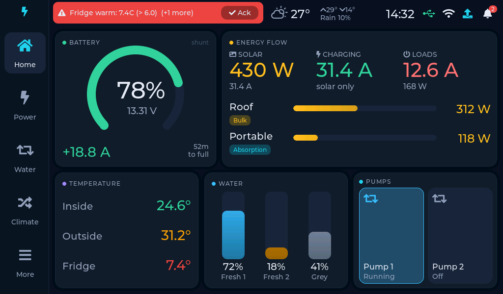
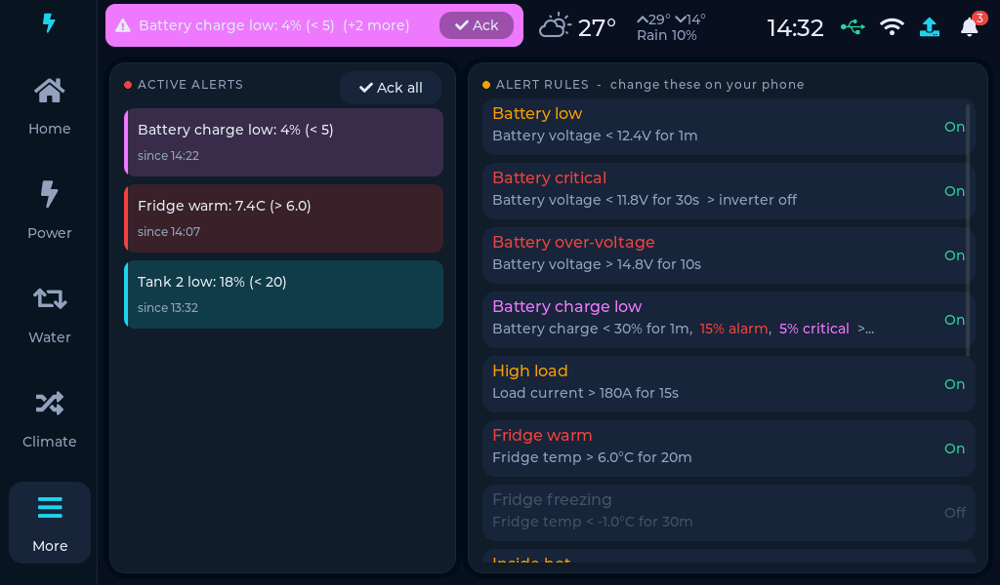
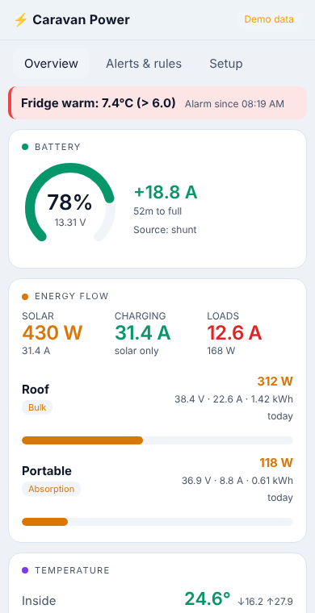

# Caravan Power

An ESP32 system that links all of the caravan's power, water and climate systems together. It shows them on a **7" Waveshare touchscreen** inside the van, serves a **web dashboard you can open from anywhere** over Starlink, and sends **push alerts to your phone**.

It talks to the BMPRO system **wirelessly through the OdysseyLink** (the same Bluetooth link the Odyssey phone app uses). Battery, tank levels and pump control need no extra wiring, and the touchscreen **replaces the Trek 3**.

> **Status:** BMPRO doesn't publish the OdysseyLink's Bluetooth protocol, so it has to be captured and decoded once before battery, tanks and pumps appear. The hub includes the tools for this, and [docs/BMPRO_INTEGRATION.md](docs/BMPRO_INTEGRATION.md) walks through it. Solar, temperatures, inverter, aircon, alerts and cloud access work without it.

| Touchscreen: home | Touchscreen: alarm |
|---|---|
|  |  |
| **Power** (per-MPPT tracking + 30 min history) | **Water** (tanks + pump control) |
|  |  |
| **Climate** (temps, aircon presets, inverter) | **Alerts** (active alerts + editable rules) |
|  |  |

Remote dashboard (desktop and phone, dark and light):

 

> The screenshots are rendered from the real UI code (see [`tests/sim`](tests/sim)), with demo data.

## What it does

| Requirement | How |
|---|---|
| Battery %, load amps, charge amps | From the BMPRO via the OdysseyLink (Bluetooth). Charge amps also from the Victrons. Fallback: INA226 shunt |
| Individual solar controller tracking | Both Victron SmartSolar 100/50s over **VE.Direct**: PV W/V, charge A, state, yield today, peak, errors |
| Inside / outside / fridge temps with alarms | 3 × DS18B20; min/max today; alarm rules with delay and hysteresis |
| Customisable alerts on temps, volts and amps | Rule engine: any metric, above/below, threshold, hysteresis, delay, severity, push on/off, plus an optional **automatic action** (aircon off, inverter off, pumps off) |
| Phone alerts | [ntfy](https://ntfy.sh) push (free iOS/Android app). Alarms use *urgent* priority |
| 2 water pumps on the touchscreen | Switched **by the BMPRO**, commanded over Bluetooth, so the Odyssey app stays in sync. Dry-run lockout and a max run time. Fallback: relays |
| Water tank gauges | The existing tank senders, read through the OdysseyLink (no wiring). Fallback: ADS1115 taps |
| Remove the Trek 3 | The touchscreen covers everything the Trek showed. Follow the test-before-removing steps in the BMPRO doc |
| Inverter control | Relay on the Powertech remote port (pulse or latch), with a 240 V output sense |
| Air-con control | Learns IR codes from the Houghton remote and replays them (up to 8 presets plus OFF) |
| Remote access over Starlink | Outbound MQTT over TLS, so it works behind Starlink CGNAT with no port forwarding |
| Modern UI on the 7" Waveshare | LVGL 8.3 dark UI, 800×480, nav rail plus 6 pages, screen sleep with wake on alarm |

## Architecture

```
                         Starlink ── internet ── MQTT broker (TLS) ── phone / laptop dashboard
                             │                        ▲                  (web/index.html)
                         Wi-Fi                        │ outbound only            ntfy push
                             │                        │                              ▲
 ┌───────────────────────────┴────────────────────────┴──────────────────────────────┴────┐
 │ HUB  ESP32-S3-DevKitC-1                                                                │
 │  Bluetooth ))))) OdysseyLink ── BMPRO 35A: battery, 3 tank senders, pump 1 + 2       │
 │  VE.Direct ×2 ── SmartSolar 100/50 #1, #2       1-Wire ── DS18B20 inside/outside/fridge│
 │  Relay ── inverter remote      Opto ── inverter 240 V present                          │
 │  IR LED / IR receiver ── Houghton aircon                                               │
 │  Local web UI http://caravan.local  +  WebSocket                                       │
 │  (optional wired fallbacks: INA226 shunt, ADS1115 tank taps, pump relays)              │
 └──────────────────────────────┬─────────────────────────────────────────────────────────┘
                                │ RS485 (4-core: 12 V, GND, A, B)
 ┌──────────────────────────────┴───────────────┐
 │ DISPLAY  Waveshare ESP32-S3-Touch-LCD-7      │      Trek 3: removed
 │  800×480 LVGL touchscreen (replaces Trek 3)  │      Odyssey phone app: still works
 └──────────────────────────────────────────────┘
```

**Why two ESP32s?** On the Waveshare 7" board almost every GPIO drives the RGB panel. The only spare I/O is the RS485 port, I²C and a CAN port. So the screen is a pure UI and a cheap ESP32-S3 dev board does all the wiring-heavy work. The wired RS485 link keeps working when Wi-Fi or Starlink is off.

Everything speaks one JSON format (`firmware/lib/CaravanCommon`), whether over the RS485 link, the local WebSocket or MQTT. So the touchscreen, the local web page and the remote dashboard all see the same data and send the same commands.

## Repository layout

```
firmware/
  lib/CaravanCommon/   shared: data model, JSON format, alert engine, VE.Direct parser,
                       SoC estimator, RS485 framing (portable C++, host-tested)
  hub/                 PlatformIO project - ESP32-S3 hub
  display/             PlatformIO project - Waveshare ESP32-S3-Touch-LCD-7
web/index.html         dashboard (local + cloud), single file, no build step
tests/                 host unit tests (make -C tests) + UI simulator (tests/sim)
docs/                  wiring, cloud setup, BMPRO notes, protocol reference
```

## Quick start

1. **Wire it up.** Follow [docs/WIRING.md](docs/WIRING.md): the RS485 link to the display, the two Victron cables, the temperature probes, the inverter relay and the IR LED. Nothing touches the BMPRO wiring.
2. **Set up the cloud side** (optional; the system runs fully offline without it) using [docs/CLOUD_SETUP.md](docs/CLOUD_SETUP.md): a free HiveMQ Cloud broker plus the ntfy app.
3. **Flash the hub.**
   ```sh
   cd firmware/hub
   cp src/secrets.example.h src/secrets.h    # Wi-Fi, MQTT, ntfy topic, web password
   pio run -t upload                          # firmware
   pio run -t uploadfs                        # web dashboard -> LittleFS
   pio device monitor                         # watch it find sensors
   ```
4. **Flash the display.**
   ```sh
   cd firmware/display
   pio run -t upload
   ```
5. **Commission it** from the touchscreen, under **Settings**:
   - Connect to the OdysseyLink and decode its protocol: [docs/BMPRO_INTEGRATION.md](docs/BMPRO_INTEGRATION.md). Tanks are calibrated in the Odyssey app as before.
   - Learn the aircon presets: set the Houghton remote to e.g. *Cool 22 auto*, tap *Learn preset* and press the remote's button. Repeat for each mode you use, then do *Learn OFF*.
   - Check the temperature sensors went to the right roles. Use the web dashboard → *Setup* → *Scan 1-Wire bus* to reassign them.
6. **Tune the alert rules** on the Alerts page (+/− thresholds) or in the dashboard (full editor). The defaults suit 12 V lithium: see `loadDefaultRules()` in [`CaravanModel.cpp`](firmware/lib/CaravanCommon/src/CaravanModel.cpp).
7. **Remove the Trek 3** once the touchscreen shows battery, tanks and pumps from the BMPRO, and after the unplug test in the BMPRO doc passes.

## BMPRO integration status

- **Bluetooth connection:** the hub keeps a permanent connection to the OdysseyLink, logs every frame, and can replay writes captured from the Odyssey app.
- **What's left:** two functions to fill in once the protocol is decoded, `Bmpro::decode()` (battery, tanks, pump state) and `Bmpro::encodePump()` (pump on/off).
- **Procedure:** see [docs/BMPRO_INTEGRATION.md](docs/BMPRO_INTEGRATION.md). It uses an Android Bluetooth capture of the Odyssey app, which is the quickest way.
- **If decoding hits a wall** (e.g. encrypted traffic), the wired fallbacks need no code changes, only config and hardware: INA226 shunt, ADS1115 tank taps, pump relays.

## Testing

```sh
git clone --depth 1 -b v7.2.1  https://github.com/bblanchon/ArduinoJson ../ArduinoJson
git clone --depth 1 -b v8.3.11 https://github.com/lvgl/lvgl ../lvgl
make -C tests                 # 77 unit checks under ASan/UBSan: VE.Direct parser, alert engine,
                              # JSON round-trip, SoC estimator, RS485 framing
make -C tests/sim             # builds the real display UI against LVGL and renders every page to PNG
```

Open `web/index.html?demo` in a browser to try the dashboard with fake data.

## Safety

- **240 V:** In Australia, any work on the 230 V side (the inverter output sense) must be done by a licensed electrician (AS/NZS 3001). Everything else here is 12 V.
- **Fusing:** Fuse every new 12 V feed at the source: 2 A for the hub/display (and pump-rated fuses if you use the relay fallback).
- **Pump backup:** the Odyssey phone app keeps working alongside the hub, so you can still run the pumps if the hub is ever down.
- **Load shedding:** Automatic actions only ever turn things **off**. Nothing is switched on without a person pressing a button.
- **Remote control:** It can be disabled from the touchscreen (Settings → *Allow remote control*). That switch can't be changed from the cloud.
