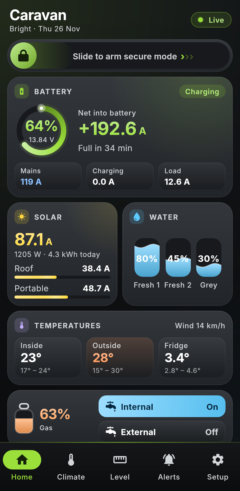
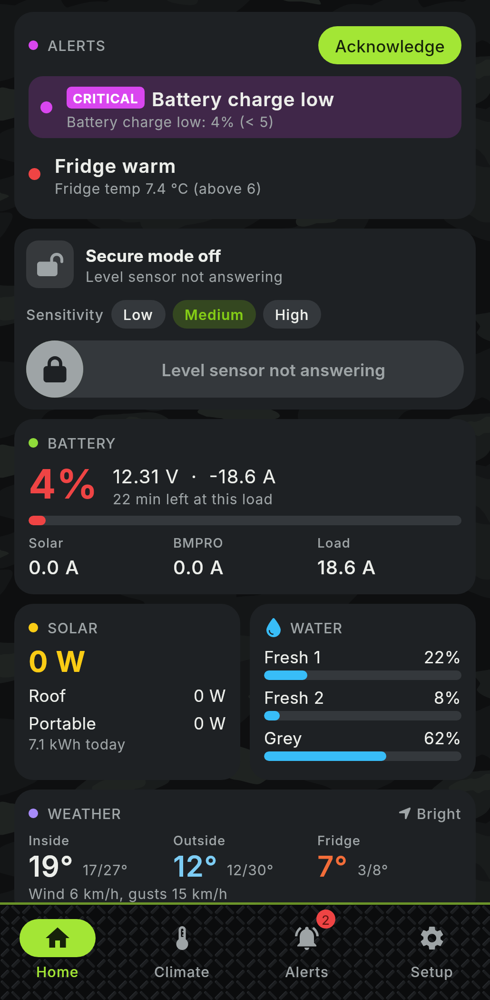
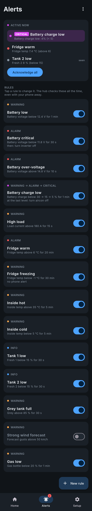
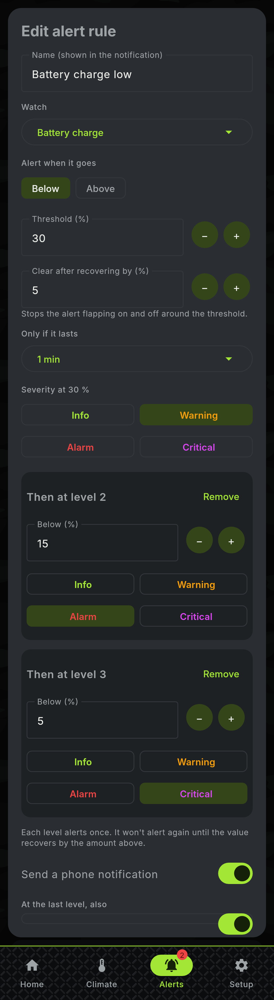
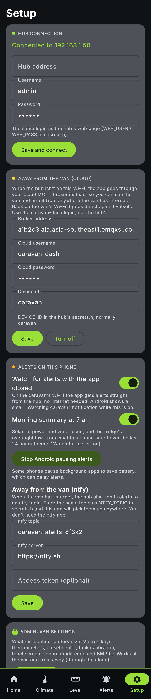
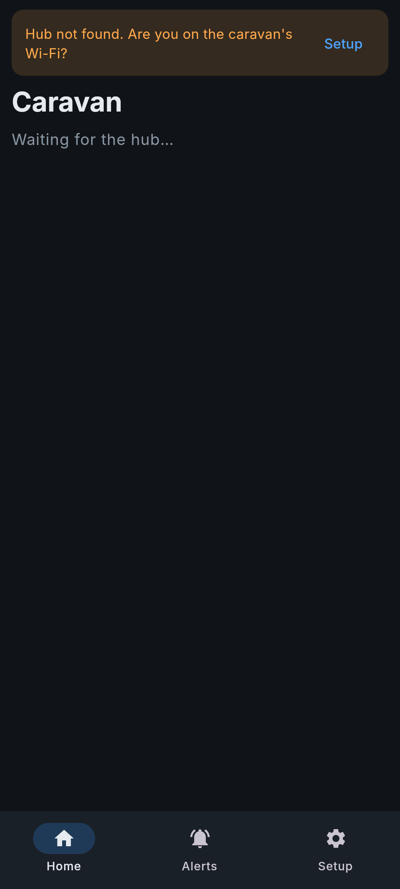

# Caravan Android app

Native Kotlin (Jetpack Compose) app for the caravan hub. It replaces the slow
touchscreen for setup and sends alerts as phone notifications.

## What it does

- **Home:** battery, mains charging (while bulk charging), solar, water tanks, temperatures,
  gas bottle, Internal/External pumps (tap to switch), weather.
- **Alerts:** active alerts with *Acknowledge*, and the hub's alert rules: add, edit,
  delete, switch on/off, restore defaults. Same rules as the touchscreen and web page.
  A rule can step up through up to two more levels, e.g. battery charge below 30 %
  warning, below 15 % alarm, below 5 % critical. Each level alerts once and re-arms
  only after the value recovers by the rule's hysteresis.
- **Setup:** hub login, background alerts, ntfy, touchscreen sleep time, remote control.
- **Notifications:**
  - On the caravan's Wi-Fi the app holds a connection to the hub and raises a
    notification for each new alert, with an *Acknowledge* button. No internet needed.
  - Away from the van it listens to the hub's ntfy topic (`NTFY_TOPIC`), which works
    whenever the van has internet. If the van is offline, nothing can reach the phone.
  - Rules with *Send a phone notification* off are skipped.
  - Critical alerts use their own "Critical alarms" channel with the alarm sound.
- **Worked out on the phone** (no extra work for the hub), from a small log the app keeps
  while it's connected (10-minute slices, 8 days, in `usage.csv`):
  - battery time left at the current load, averaged over ~15 min ("About 2 days left");
  - gas days left, from a straight-line fit to the last week of bottle readings
    (since the last refill), shown under the gas %;
  - a **morning summary** notification at 7 am (Setup switch): solar in yesterday,
    Ah used and water used in the last 24 h, the fridge's overnight low, battery and gas now.
    If the app only heard from the van for part of the day it says so.
  All of it blanks out while the data isn't live.

## Updates

Every push to `main` or the app branch builds the APK and publishes it as a GitHub
release `app-build-<n>` (the build number is also the versionCode). All builds are
signed with the committed key `app/debug.keystore`, so each one installs over the last.
The app checks for a newer release when it opens and shows **Update** on Home. Tapping it
downloads the APK and opens Android's install screen.

The repository is private, so the app needs a GitHub token to read releases. In GitHub,
create a fine-grained token for this repository only, with Contents set to Read-only,
then paste it into Setup → App updates. The token stays on the phone.

## How it talks to the hub

Exactly like the web page (see `docs/PROTOCOL.md`):

1. `GET http://<hub>/api/token` with HTTP Basic auth (`WEB_USER` / `WEB_PASS`).
2. WebSocket `ws://<hub>:81/`, send `{"c":"auth","tok":…}`, then `{"c":"hello"}`.
3. The hub pushes `{"t":"state",…}` every second; commands are the usual `{"c":…}` JSON.

The hub is found with Android's DNS-SD discovery (`_http._tcp`, name `caravan`),
because many phones can't open `caravan.local`. Then `caravan.local` is tried, and
the address that worked is remembered. You can also type an address in Setup.

## Installing

GitHub Actions builds the APK on every push that touches `android/`
(workflow **android**, artifact **caravan-monitor-apk**).

1. Download the artifact from the workflow run and unzip it.
2. Copy the `.apk` to the phone and open it (allow "install unknown apps" for your file
   manager), or with USB debugging on: `adb install -r caravan-monitor-xxxxxxx.apk`.
3. Open the app, allow notifications, enter the hub password in Setup.

Every build is signed with the same key (`app/debug.keystore`, committed on purpose),
so a new APK installs over the old one and keeps your settings.

## Building locally

Android Studio (open the `android/` folder), or with an Android SDK installed:

```
cd android
./gradlew testDebugUnitTest assembleDebug
```

## Not in this version yet

- Victron keys, Bluetooth thermometers, tank calibration, BMPRO and weather location
  setup (use *Open hub web page* in Setup for now).
- Level page over Bluetooth (use `web/level.html` for now).
- Remote dashboard over MQTT.
- Inverter and aircon controls (hidden for now, like on the touchscreen).

## Screenshots

`android/screenshots/` draws the app's real screens with demo data, on a normal
computer (no Android SDK, emulator or phone needed):

```
cd android/screenshots
./gradlew run        # writes out/*.png
```

The screen code that doesn't touch Android lives in `ui/*Content.kt`,
`ui/Common.kt`, `ui/Colors.kt` and `ui/AppScaffold.kt`, and the renderer compiles
those files directly. `ui/Screens.kt` wires them to the hub on the phone. The
font is Inter instead of Android's Roboto, so spacing can differ slightly.

| Home (mains charging) | Home (alerts) | Alerts and rules |
|---|---|---|
|  |  |  |
| **Edit a rule** | **Setup** | **Hub not found** |
|  |  |  |
