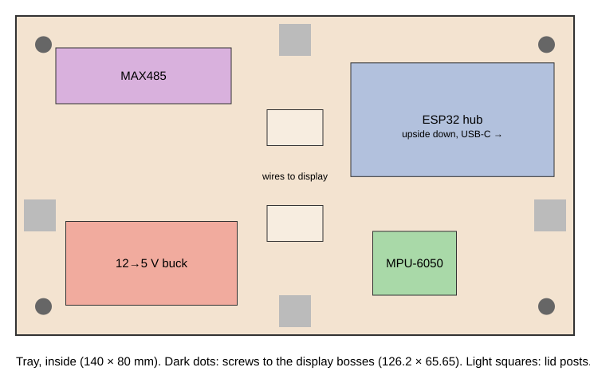

# Hub backpack for the 7" display (3D print)

A small box that bolts onto the four grey screw bosses on the back of the Waveshare ESP32-S3-Touch-LCD-7B. It holds the hub ESP32, the MPU-6050 level sensor, the MAX485 module and the 12→5 V buck converter. Its lid screws to the wall, so the display hangs in front of it, and a single 12 V cable comes in through the lid.



| File | What | Print |
|---|---|---|
| `tray.stl` | The box. It carries the parts, and screws to the display bosses through its floor. | Floor down, no supports. PETG or ASA (a caravan gets hot). |
| `lid.stl` | Closes the tray and screws to the wall. | Flat, rim up. |
| `spacer.stl` | **Print 4.** These hold the tray clear of the display's own circuit board. | Upright. |

The box is 140 × 80 mm and adds about 50 mm behind the display.

## Check before printing

These numbers come from photos, so measure them on the real parts and edit `PARAMS` in `mount.py` if they differ:

- **`boss_dx`, `boss_dy`:** the boss hole spacing, centre to centre. The default is 126.2 × 65.65 mm, the Raspberry Pi 7" display pattern, which the photos match within a couple of mm. The tray's holes are slotted ±1.5 mm along the long side to absorb small errors.
- **`boss_screw_d`:** clearance for the boss thread size. It's set for M3; use 2.9 for M2.5.
- **`spacer_h`:** from the top of a boss to the top of the tallest thing on the display board, including the USB-C plug, plus about 2 mm. The default is 14 mm.
- **ESP32 holes:** set to 44.6 × 23.7 mm, measured from the DevKit V1 photos.

Then run:

```sh
pip install manifold3d trimesh
python mount.py      # rewrites the STLs and layout.svg
```

## Assembly

1. **Mount the parts in the tray:**
   - **ESP32:** mount it **upside down** (pins toward the lid) on its four standoffs, using M2.5 self-tapping screws. Its USB-C port lines up with the notch in the end wall, so you can flash it without taking anything apart.
   - **MPU-6050:** mount it on its two standoffs. It needs to be solid; any angle is fine, because *Set level* calibrates it out.
   - **MAX485 and buck converter:** hold them down with zip ties through the slot pairs, with foam tape underneath.
2. **Wire it up** per [docs/WIRING.md](../../docs/WIRING.md#hub-on-a-classic-esp32-mounted-behind-the-display). Run the display's USB-C power lead and the RS485 A/B pair down through the two centre slots. A right-angle USB-C plug fits best.
3. **Fit the tray to the display:** put a spacer on each boss, then fit four M3 × 20 screws from inside the tray, through the floor and the spacers, into the bosses.
4. **Lid to the wall:** screw the lid to the wall over the old Trek 3 spot with four countersunk screws, and feed the 12 V cable through its centre hole.
5. **Hang the display:** connect the 12 V to the buck, fit the tray onto the lid's rim, and fix it with four M3 self-tapping screws through the lid into the posts.
